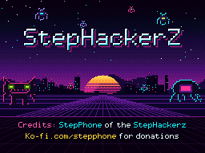

# Zoids Dash — English Translation

By **StepPhone of the StepHackerZ**. **v0.3-beta — test release.**

An unofficial English translation patch for the Japanese Nintendo DS game **Zoids Dash** (game code **AZHJ**). Supply your own clean Japanese ROM; no game ROM or emulator is included.

## Download and patch

Download [Zoids-Dash-English-v0.3-beta.zip](https://github.com/StepPhone/zoids-dash-english/releases/download/v0.3-beta/Zoids-Dash-English-v0.3-beta.zip) from the [release page](https://github.com/StepPhone/zoids-dash-english/releases/tag/v0.3-beta).

1. Extract the ZIP to get `Zoids-Dash-English-v0.3-beta.bps`.
2. Open [Rom Patcher JS](https://www.marcrobledo.com/RomPatcher.js/) or use [Floating IPS](https://github.com/Sir-Walrus/Flips/releases/tag/v198).
3. Select your **unmodified Japanese `.nds` ROM** as the source and the **`.bps` file** as the patch. Extract your ROM from its ZIP first.
4. Apply the patch and save the result as `Zoids Dash (English - Beta).nds`. Keep your original ROM.
5. Open the patched `.nds` file in your DS emulator. Testing used melonDS 1.1.

No Python, translation builder, or extracted game files are needed. The automatic GitHub source-code archives are not the recommended patch download. If the patcher reports a source checksum mismatch, your ROM does not match this release; do not force the patch.

## Supported ROM

Only the exact source below is supported. Both source and output are **67,108,864 bytes (64 MiB)**.

| File | SHA-256 |
| --- | --- |
| Clean Japanese source | `bd5c562d5e675cd95f207d83e3e63431e9662bfa427394ff8149e948dea016be` |
| Patched English beta | `0c62bd907af7ee7c0ffd1fa94f9c6ce95e2ed8e0770e8457df63082260b72026` |

On Windows, check your source with PowerShell: `Get-FileHash -Algorithm SHA256 'Zoids Dash (Japan).nds'`.

## Boot credits

Version 0.3 uses the new native 256×192 StepHackerZ credits artwork on the lower screen during the publisher splash, before the title menu. It fills the screen at its original pixel dimensions, with no resizing or cropping. The original publisher logo remains on the upper screen.

Apply this version to a **clean Japanese ROM**, not an already-patched English ROM.

## Included scope

The build translates 205 embedded strings, 20 opening/ending dialogue strings, 442 sprite labels, and main interface background labels. Changes cover mission text, tutorial conversations, menus, equipment, results, battle banners, and gameplay labels. The text renderer supports an 8-pixel-wide English font and line breaks.

## Test status and known limitations

- Checked in melonDS: boot credits and automatic transition to the title menu, title menu, opening dialogue, name entry, transition to the hub, multi-line hub/mission information, mission selection, equipment charts, and first-mission startup.
- The complete campaign, ending, every equipment combination, wireless multiplayer, and physical DS hardware have **not** been playtested.
- The Japanese title logo, staff credits, and preset handwritten player name remain. You can draw your own player name. Audio is unchanged.
- Some equipment names are literal translations, mission descriptions are condensed to fit storage limits, and image labels use simpler fonts. Further text or layout issues may remain.

Click the lower screen to advance conversations. Assign controls in melonDS under **Config → Input and hotkeys**. Start a new game for initial testing. Save compatibility is unverified; keep backups before reusing an existing save. Most emulators associate saves with the ROM filename, so the English filename normally gets a separate save.

## Verification

The BPS patch was applied to the clean Japanese ROM using Floating IPS v198. The result matched the English beta byte for byte. The build also passed checks for ROM/FAT bounds, archive layout, header CRC, unchanged sound data, text storage limits, control codes, and line lengths. See [verification.json](verification.json) and [SHA256SUMS.txt](SHA256SUMS.txt). These checks do not replace a full playthrough.

## Report an issue

Include the patch version, source-ROM SHA-256, emulator/version or hardware, steps to reproduce, and a screenshot when useful. Do not attach ROMs or other game files.

## Credits

Translation project: **StepPhone of the StepHackerZ**. [Support StepPhone](https://ko-fi.com/stepphone).

Patch creation and verification: [Floating IPS](https://github.com/Sir-Walrus/Flips). The original game and assets belong to their respective rights holders. This is an unofficial fan project. The development workspace, ROMs, saves, and emulator are not included in this public repository.
